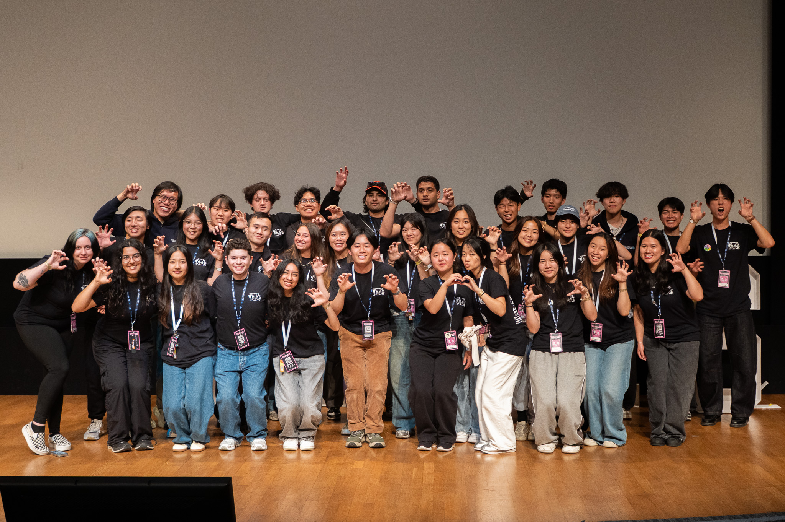

👋 Hi, my name is Jay. I'm from Canada; these days I live in the Bay Area and study Electrical Engineering and Computer Science at UC Berkeley.

Right now I'm an IT Engineer at Conviva, where I build identity and access automation and internal AI tooling. Before that I was a Security Engineering Intern at Illumio, where I built internal tooling for identity and access management.

At school I help organize Cal Hacks with Hackathons @ Berkeley, where I work with the logistics team to do everything *logistical!*

You can email me at jaychong@berkeley.edu, or find me at jckizumi.com and on LinkedIn.
